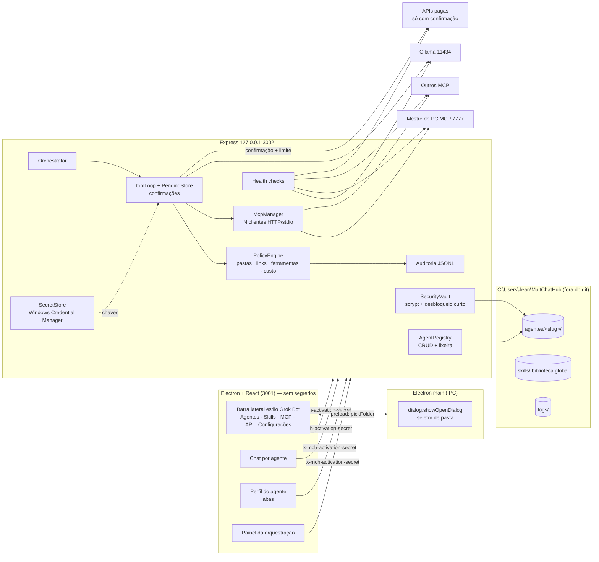
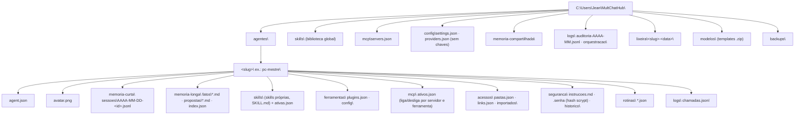
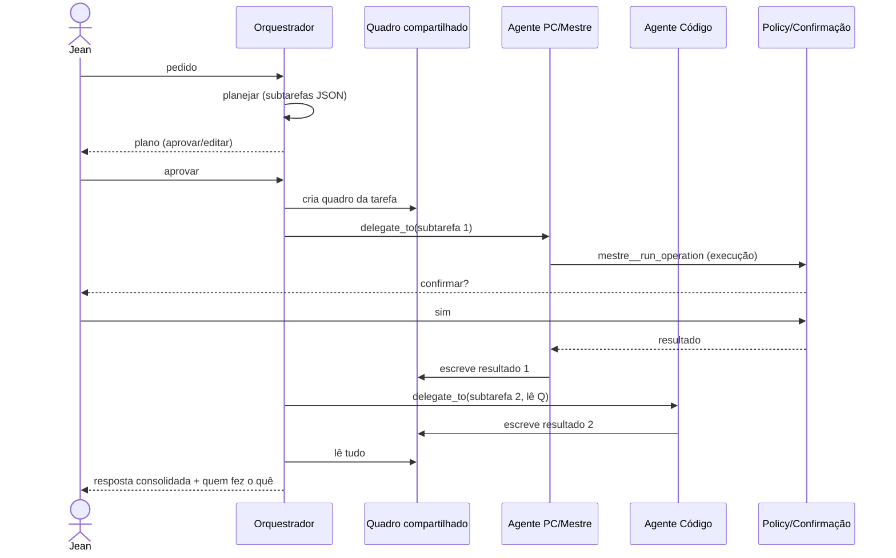
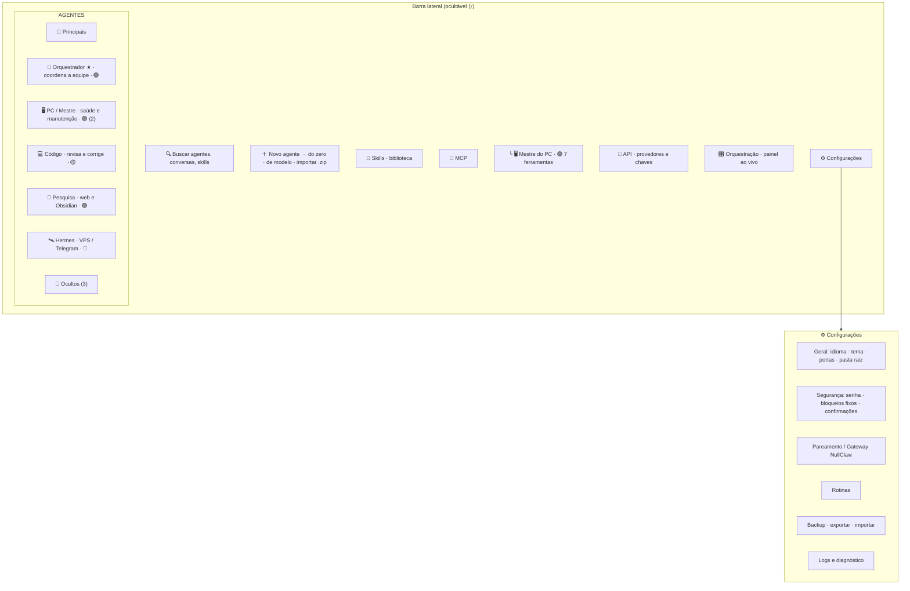

# Plano — Agentes editáveis no MULT-CHAT-HUB lite

> **Status:** só plano, nada foi implementado. Escrito em 20/11/2026 a partir do código real de `apps/lite` (commit `0964700` + mudanças locais não commitadas) e do Mestre do PC V10.
> **Pedido do Jean:** criar, editar, duplicar e excluir todos os agentes no app. Cada agente com pastas próprias (memória curta, memória longa, skills, ferramentas/plugins, MCP, acessos e segurança). Acesso a pastas locais e links com permissões e proibições. Pasta de segurança protegida por senha simples. Nada é criado ou alterado sem o clique do Jean. Seções próprias para **MCP do Mestre do PC**, **API** e **Configurações**. Um **orquestrador** escolhido pelo Jean. Visual no estilo dos **bots do Grok Bot**.

---

## 0. O que existe hoje (diagnóstico do código)

| Área | Situação atual | Problema |
|---|---|---|
| Lista de agentes | `DEFAULT_AGENTS` fixo em `src/context/ChatContext.tsx` (11 agentes), em `useState`; `registerAgent` e `updateAgent` só na memória | **Não tem persistência nem exclusão.** Ao recarregar, volta ao padrão. Não existem pastas por agente. |
| Tipo `Agent` (`src/types.ts`) | `name, specialty, description, permissions[], provider, status, thinkingLevel, tools[], gatewayId?` | Sem `id`, prompt, modelo, skills, MCP, memória ou acessos. O `status: 'Ativo'` é um texto fixo, não vem de uma checagem real. |
| Orquestrador Hub | A descrição aponta para `fazendaavila2026/avila`. `agentController.ts` usa `OLLAMA_MODEL` com fallback `fazendaavila2026/avila:latest` | O modelo não existe no PC. O `.env.local` já usa `jeanavila997/agente-model-file:latest`, mas o fallback e o texto continuam errados. |
| Provedores (`ProviderName`) | 18 entradas misturadas: APIs, CLIs (`codex`, `claude_code`, `opencode`, `powershell`, `cli`), agentes (`hermes`, `grok_bot`) e roteadores (`router9`, `openrouter`) | Era a crítica do Jean. O `opencode` tem `baseUrl` da OpenAI, por isso aparece com o rótulo "OpenAI". |
| **Chaves de API** | Ficam em `providerConfig` no **localStorage** do front (`persistState`) e vão no corpo de cada `POST /api/chat` (`apiKey: cfg.apiKey`) | **As chaves ficam no navegador.** Isso fere a regra "sem segredos no front". |
| Segredo de ativação | `VITE_APP_ACTIVATION_SECRET` no `.env.local`, lido por `src/lib/backendAuth.ts` | O Vite **embute o segredo no bundle do front**. Ele vale como trava contra acesso por engano, não como segredo de verdade. |
| Skills | `server/agent/skills.ts` lê `<dir>/<nome>/SKILL.md` (só leitura, 64 KB, nome validado). `SKILLS_DIRS="skills;C:/Users/Jean/.ollama/agente-model-file/skills"`. As skills ativas são `diagnostico-pc`, `codigo`, `criador-de-skills` e `revisao` | Uma lista global só, sem escolha por agente e sem categorias. |
| Ferramentas | `server/agent/agentTools.ts` tem ferramentas internas, GitHub, Obsidian, Supabase, Hermes, n8n e `mestre_*` via MCP. A confirmação fica em `requiresConfirmation` e o `toolLoop.ts` usa `PendingStore` | Bom ponto de partida. Falta liberar ou bloquear cada ferramenta por agente. |
| MCP | `server/agent/mcpClient.ts` (Streamable HTTP, JSON-RPC, SSE, `Mcp-Session-Id`, `Authorization: Bearer`). Tem **um** servidor fixo: `MESTRE_MCP_URL=http://127.0.0.1:7777/mcp`. A leitura vem de `MESTRE_MCP_READONLY_TOOLS` | Só aceita um servidor, e só HTTP (não tem stdio). |
| Servidor | Express em `127.0.0.1:3002` com `requireActivationSecret` e `rateLimit`. Rotinas em `data/routines.json`, gateway NullClaw, `/health` público | Boa base de segurança. |
| Electron | `main.cjs` sobe o `server-dist/index.js` como processo filho. `preload.cjs` só expõe `platform` e `version`. `contextIsolation: true` | Não tem seletor de pasta nativo (IPC). O `safeStorage` só existe no processo principal do Electron, não no servidor. |

### De onde vêm os skills da tela de cards (`/roundtable-review`, `/mcp-builder`, …)
Essa tela **não é do MULT-CHAT-HUB**: nenhum arquivo do repositório tem "ORQUESTRAÇÃO" nem `roundtable`. Os skills estão espalhados no PC:
- `C:\Users\Jean\.agents\skills\` tem **138 skills**, entre elas `diagnosing-bugs`, `systematic-debugging`, `improve-codebase-architecture`, `dispatching-parallel-agents` e `subagent-driven-development`.
- `C:\Users\Jean\.claude\skills\synced\…\mcp-builder\` (Claude).
- `C:\Users\Jean\.claude\plugins\synced\…\desktop-commander\…` (plugin do Claude, 624 SKILL.md no total).
- `roundtable-review` **não foi encontrado** nas pastas verificadas. Deve ser um skill de um app (Claude Desktop ou Grok Bot) que não está salvo em disco. Se o Jean quiser usar, é preciso exportar ou recriar como `SKILL.md`.
- `C:\Users\Jean\.ollama\agente-model-file\skills\` tem `codigo`, `criador-de-skills` e `revisao`. `apps/lite/skills\` tem `diagnostico-pc`.

> Não consegui abrir a imagem anexada (o arquivo é privado para mim). O catálogo abaixo usa a descrição recebida (cards por categoria com busca) e a captura que já está em `docs/` ("ajustar menu com botão de ocultar… skills em menu de seleção onde todos agentes compartilham a mesma skills").

### Mestre do PC: como a conexão funciona hoje (verificado)
- O launcher `v10/launcher.js` escuta em `MPC_HOST=127.0.0.1:7777`. A rota `/mcp` chama `handleMcpHttpEndpoint` (`v10/chat-integrado/grokbot-bridge.js`), que é stateless e **não devolve `Mcp-Session-Id`**.
- **`/mcp` não pede autenticação.** Um teste local sem token fez `initialize` e `tools/list` e recebeu as 7 ferramentas. O `isAuthorized` com `X-Mestre-Mcp-Token` é usado em `/run`, `/classify` e `/modo-livre`, **mas não em `/mcp`**. O lite manda `Authorization: Bearer ${MESTRE_MCP_TOKEN}`, e o Mestre ignora esse cabeçalho.
- Ferramentas expostas: `mestre_system_status`, `mestre_list_operations`, `mestre_list_memories` (leitura); `mestre_save_memory` (escrita); `mestre_run_operation` (executa um item da whitelist de 506 comandos, alguns marcados `destructive`); `mestre_optimize_ram_and_temp` (**esvazia a Lixeira** e limpa temporários, então é destrutiva); `mestre_ask_grok` (chama o 9Router, **pode custar dinheiro**).
- Health: `GET /health` (200) e `GET /mcp-status`.
- ⚠️ **Risco a corrigir no Mestre (fase 0):** como `/mcp` está aberto, qualquer processo local, e talvez uma página web com POST "simples" (`text/plain`, sem preflight de CORS), poderia chamar `tools/call`. O lite **não deve** depender disso. Proposta: no Mestre, exigir `X-Mestre-Mcp-Token` em `tools/call` e recusar `Content-Type` diferente de `application/json`. No lite, mandar `X-Mestre-Mcp-Token` além do Bearer. **Nunca** expor `/run-free` nem `/modo-livre` como ferramentas.

---

## 1. Visão geral da nova arquitetura



Princípios:
1. **O servidor é quem decide.** O front só mostra e pede, e toda permissão é checada no Express.
2. **Os segredos nunca chegam ao front.** As chaves ficam no Credential Manager, e a UI só vê `•••• últimos 4`.
3. **Nada muda sem o Jean.** O agente só *propõe* memória longa, skills e edições, e a escrita acontece depois de um clique.
4. **Nada pago automático.** Não existe fallback para provedor pago. Todo uso pago pede confirmação e respeita um limite.
5. **O padrão é negar.** Um agente novo começa sem pastas, links ou ferramentas de escrita.

---

## 2. Modelo de dados

### 2.1 `Agent` (salvo em `agentes/<slug>/agent.json`)
```ts
interface AgentV2 {
  id: string;              // uuid, nunca muda
  slug: string;            // nome da pasta (a-z0-9-), único
  version: 2;
  name: string;            // "PC / Mestre"
  subtitle: string;        // linha curta na barra lateral (estilo Grok Bot)
  description: string;
  avatar: { emoji?: string; image?: string /* avatar.png na pasta */; color: string };
  section?: string;        // pasta/seção na barra lateral ("Trabalho", "Fazenda")
  hidden: boolean;         // ocultar da barra lateral
  pinned: boolean;
  isDefault: boolean;      // veio do pacote padrão (pode ser restaurado)
  templateId?: string;     // criado a partir de qual modelo
  model: { provider: ProviderId; model: string; thinking: 'LOW'|'HIGH'; temperature?: number };
  prompt: { system: string; agentic?: string };   // "system prompt" + "prompt agêntico" (pedido da captura)
  skills: string[];        // nomes da biblioteca global ativados para este agente
  tools: { name: string; enabled: boolean; confirm: 'auto'|'always'|'never-run' }[];
  mcp: { serverId: string; enabled: boolean; tools: Record<string, { enabled: boolean; confirm?: 'always'|'auto' }> }[];
  memory: { shortTerm: { maxMessages: number; ttlDays: number }; longTerm: { enabled: boolean; backend: 'files'|'files+supabase'; embeddings?: 'ollama:nomic-embed-text' }; shared: boolean };
  access: { folders: FolderGrant[]; links: LinkRule[] };   // detalhes no §4 e §5
  limits: { maxToolSteps: number; maxPaidCallsPerDay: number; maxPaidUsdPerDay: number };
  orchestration: { canBeDelegatedTo: boolean; colleagues: string[] /* ids que ele pode chamar */ };
  routines: string[];      // ids das rotinas deste agente
  createdAt: string; updatedAt: string; updatedBy: 'jean';  // o agente nunca grava este arquivo
}
```
**O `status` não é salvo.** Ele é calculado a cada consulta por `GET /api/agents/:id/health`:
- 🟢 **verde:** modelo respondeu e todas as dependências obrigatórias estão OK;
- 🟡 **amarelo:** funciona, mas falta algo opcional (MCP fora do ar, ferramenta sem chave), ou o modelo é pago;
- 🔴 **vermelho:** modelo inexistente, provedor sem chave ou Ollama parado.

### 2.2 Tipos de provedor (fim da lista misturada)
```ts
type ProviderKind = 'local' | 'ollama-cloud' | 'api' | 'router' | 'cli' | 'agent';
interface Provider { id; label; kind; baseUrl?; paid: boolean; secretRef?: string; configured: boolean; health: 'ok'|'warn'|'down' }
```
- **local:** Ollama (só os modelos sem `:cloud`) e llama.cpp.
- **ollama-cloud:** modelos `*:cloud`, como `deepseek-v4.1-flash:cloud` e `glm-5.3-flash:cloud`. São `paid: true` e pedem confirmação. O `clef:cloud` sai da lista, porque quebra com "decision model".
- **api:** OpenAI, Anthropic, Gemini, DeepSeek, NVIDIA NIM, Cloudflare Workers AI e xAI/Grok.
- **router:** 9Router (local, `127.0.0.1:20128`) e OpenRouter.
- **cli:** Codex, Claude Code, OpenCode e PowerShell. Eles **não aparecem como "LLM da conversa"**. Viram *ferramentas* de execução com confirmação. O OpenCode deixa de ter o rótulo "OpenAI".
- **agent:** Hermes (VPS, via túnel) e Grok Bot. São agentes externos, chamados por delegação.

A lista de modelos do Ollama é deduplicada por nome (o `jeanavila997/agente-model-file:latest` deixa de aparecer duas vezes).

---

## 3. Pastas por agente no disco

**Recomendação: `C:\Users\Jean\MultChatHub\`** (configurável em Configurações → Geral, variável `MCH_DATA_ROOT`).
Por quê:
- fica fora do repositório, então não corre risco de commit, `git clean` ou `pnpm clean`;
- sobrevive a reinstalar ou reconstruir o app (o build empacotado roda de `resources/app.asar.unpacked`, onde não se grava);
- é fácil de achar, fazer backup e abrir no Explorer;
- `apps/lite/data/` continua só para estado técnico (`routines.json`, `provenance.jsonl`). Na fase 1, as rotinas migram para dentro do agente.



Regras de cada pasta:
- **memoria-curta/**: um JSONL por sessão de chat. Limite padrão de 200 mensagens por sessão, expiração em 14 dias (configurável) e limpeza diária. É o histórico do chat, o "contexto recente".
- **memoria-longa/fatos/**: um `.md` por fato, com frontmatter (`tipo`, `fonte`, `criado`, `aprovado_por: jean`), que o Jean pode editar no app ou no Obsidian. O agente grava **só** em `propostas/`, e a UI mostra "Aprovar / Editar / Descartar". Opcional: espelhar no Supabase (`agent_memories`, que já existe) e usar embeddings locais (`nomic-embed-text` no Ollama) para busca, sem custo.
- **memoria-compartilhada/**: mesma estrutura, e todos os agentes com `memory.shared = true` leem. É onde o orquestrador põe o "quadro" da tarefa (§9).
- **skills/** (por agente): skills próprias no mesmo formato do `skills.ts` (`<nome>/SKILL.md` com `name` e `description`). A ordem de busca é: skills do agente, biblioteca global, `SKILLS_DIRS` atual (compatível com `C:\Users\Jean\.ollama\agente-model-file\skills`).
- **ferramentas/**: `plugins.json` com as ferramentas internas habilitadas e a configuração delas (ex.: allowlist do n8n). Os plugins são **declarativos** (JSON), não código executável. Nada de `require()` de pasta importada.
- **mcp/ativos.json**: quais servidores do gerenciador global este agente usa e quais ferramentas de cada um.
- **acessos/**: `pastas.json`, `links.json` e `importados/` (cópias de pastas importadas).
- **seguranca/**: instruções protegidas e hash da senha (§6).
- O `.gitignore` da raiz ganha `MultChatHub/` por precaução. O servidor recusa um `MCH_DATA_ROOT` que esteja dentro de um repositório git.

---

## 4. Acesso a pastas locais

**Na UI (aba Acessos → Pastas):**
- **Adicionar pasta:** abre o seletor nativo do Electron. O `preload.cjs` passa a expor `pickFolder()`, que chama `ipcMain.handle('dialog:pickFolder')` e `dialog.showOpenDialog({ properties: ['openDirectory'] })`. No navegador (modo dev sem Electron), o Jean digita o caminho num campo de texto.
- **Importar pasta:** duas opções.
  - **Referenciar** (padrão): o agente acessa a pasta original, com as permissões escolhidas.
  - **Copiar**: copia a pasta para `acessos/importados/<nome>`, com limite de tamanho (500 MB, configurável). O agente trabalha na cópia e a original fica intocada.
- Permissões por pasta, desmarcadas por padrão exceto *Ler*: ☑ Ler · ☐ Escrever · ☐ Executar · ☐ Apagar. Também há globs de **permitido** (ex.: `**/*.md`, `src/**`) e de **proibido** (ex.: `**/node_modules/**`, `*.pfx`).

```ts
interface FolderGrant { id; path: string; mode: 'reference'|'copy'; perms: { read: true; write: boolean; exec: boolean; delete: boolean };
  allow: string[]; deny: string[]; addedAt: string }
```

**Bloqueios fixos** (valem para todos os agentes, nenhuma regra libera, ficam no código):
`**/.env*`, `**/*.pem`, `**/*.key`, `**/id_rsa*`, `**/.ssh/**`, `**/.aws/**`, `**/.git/config`, `**/credentials*`, `**/*secret*`, `**/.npmrc`, `C:\Windows\**`, `C:\Program Files*\**`, `C:\ProgramData\**`, `%APPDATA%\Microsoft\Credentials\**`, perfis do Chrome e do Edge (`Login Data`, `Cookies`), `C:\Users\Jean\MultChatHub\**\seguranca\**` (para escrita) e a própria `config\`.

**Como o servidor aplica** (`server/agent/policy/fsGuard.ts`):
1. `path.resolve` e depois `fs.realpathSync.native` (**resolve symlinks e junctions** antes de checar).
2. Comparação case-insensitive no Windows, com prefixo + separador (`C:\a` não pode casar `C:\ab`).
3. Bloqueia `..`, caminhos UNC (`\server\`), ADS (`file.txt:stream`), nomes reservados (`CON`, `NUL`) e caminhos com mais de 260 caracteres sem prefixo.
4. Checa bloqueio fixo, depois `deny`, depois `allow` e por fim a permissão da operação.
5. Limite de leitura de 1 MB por arquivo e de listagem de 500 itens.
6. Escrever, executar e apagar **sempre** pedem confirmação, com diff ou prévia. Apagar move para a Lixeira do Windows, nunca usa `rm` definitivo.
7. Toda tentativa, permitida ou negada, vai para `logs/auditoria-*.jsonl` e `agentes/<slug>/logs/chamadas.jsonl`.

Ferramentas novas: `fs_list`, `fs_read`, `fs_search` (leitura), `fs_write` e `fs_delete` (confirmação). **Não terá `fs_exec` no MVP.** A execução continua passando pela whitelist do Mestre.

---

## 5. Links e URLs

Aba Acessos → Links:
```ts
interface LinkRule { id; pattern: string /* "*.hostinger.com", "api.github.com/repos/jeanavila997/*" */;
  kind: 'allow'|'deny'; methods: ('GET'|'POST'|'PUT'|'DELETE')[]; confirm: boolean; note?: string }
```
- O padrão é **negar tudo**. Cada agente só acessa os domínios da lista.
- `GET` é leitura e não pede confirmação. `POST`, `PUT` e `DELETE` são escrita e **sempre** pedem confirmação.
- A denylist vence a allowlist. A denylist global fixa inclui IPs privados, link-local (169.254.x.x, que é metadata) e `localhost`, exceto as portas registradas (Ollama, Mestre, 9Router). Isso é proteção contra SSRF, e o IP é checado depois do DNS.
- Só HTTPS para domínios externos. Limites: 2 MB de resposta, 15 s, 5 redirecionamentos, cada um checado de novo.
- O conteúdo baixado entra no prompt como **dados, não instruções**. A regra já existe em `buildAgentRules`.
- Ferramentas: `web_get` (leitura) e `web_post` (confirmação). O `n8n_trigger` passa a ser uma regra de link `POST` com confirmação.

---

## 6. Pasta de segurança com senha simples

**O que é:** `agentes/<slug>/seguranca/instrucoes.md` guarda as instruções inegociáveis do agente (ex.: "nunca apague arquivos fora de X", "nunca use provedor pago"). Elas entram **no topo** do system prompt, acima de tudo, e o agente não consegue sobrescrevê-las.

**Como funciona:**
- **Criar a senha:** no primeiro uso, o Jean define uma senha (mínimo de 4 caracteres, porque é "simples"). O servidor grava `seguranca/.senha` com `scrypt` (`crypto.scryptSync`, N=2^15, sal aleatório de 16 bytes), sem dependências novas. Pode ser uma senha global ou uma por agente; a **recomendação é uma global**.
- **Desbloquear:** `POST /api/security/unlock` cria uma sessão de **5 minutos**, guardada só na memória do servidor. Fechar o app bloqueia de novo.
- **Editar:** só com a sessão ativa. Cada versão salva vai para `seguranca/historico/AAAA-MM-DD-HHmm.md`, com o diff visível.
- **O agente lê, mas não escreve.** Nenhuma ferramenta tem permissão de escrita em `**/seguranca/**` (bloqueio fixo no `fsGuard`). As rotas de edição exigem a sessão de desbloqueio, que nenhuma ferramenta consegue obter.
- **Senha errada:** depois de 5 tentativas, espera de 1 minuto.
- **Esqueci a senha:** botão "Redefinir" em Configurações → Segurança. Ele pede confirmação dupla, digitando `REDEFINIR`, e o segredo de ativação do app. As instruções **não se perdem**, porque não são criptografadas, só protegidas contra edição. O hash é trocado e o evento fica na auditoria.
- ⚠️ **Limite, para ficar claro na própria tela:** a senha simples evita edição **por engano ou pelo agente**. Ela **não protege** contra quem tem acesso ao PC, porque o arquivo `.md` pode ser aberto no Bloco de Notas. Para sigilo de verdade seria preciso criptografia (fora do escopo).

**"Só criar e editar quando eu quiser":** é uma regra geral do app.
- O agente **nunca** cria agente, skill, rotina, memória longa, regra de acesso ou servidor MCP sozinho.
- Ele pode **propor**. A proposta aparece num cartão no chat ("Salvar esta memória?", "Criar a skill X?"), com prévia, e só é gravada depois do clique em *Aprovar*.
- As ferramentas `memory_save`, `mestre_save_memory` e `skill_propose` gravam só em `propostas/`.

---

## 7. MCP: gerenciador geral

**Arquivo global:** `MultChatHub\mcp\servers.json`. Os tokens não ficam nele, e sim no SecretStore.
```ts
interface McpServer { id: string; label: string; transport: 'http'|'stdio';
  url?: string;                         // http
  command?: string; args?: string[]; cwd?: string; env?: Record<string,string /* "secret:ID" */>; // stdio
  authHeader?: 'Authorization'|'X-Mestre-Mcp-Token'; secretRef?: string;
  builtin?: boolean;                    // Mestre = true (não pode ser excluído, só desligado)
  toolClasses: Record<string, 'leitura'|'escrita'|'execucao'|'destrutiva'|'paga'>;
  enabled: boolean }
```
- **`McpManager`** (`server/agent/mcp/manager.ts`) gerencia vários clientes. Ele reaproveita o `McpHttpClient` atual (que já trata JSON e SSE com `Mcp-Session-Id`) e ganha:
  - um `McpStdioClient` novo (JSON-RPC em stdin/stdout com `child_process.spawn`, **sem `shell: true`**, timeout, encerramento ao fechar o app), para servidores como o `desktop-commander`;
  - o cabeçalho de autenticação configurável (`X-Mestre-Mcp-Token`).
- **Na UI:** *Adicionar servidor* (HTTP: URL e token; stdio: comando, argumentos e variáveis), *Testar* (`initialize` e `tools/list`, mostrando a latência), *Ligar/Desligar* e *Ver ferramentas*.
- **Classificação:** cada ferramenta recebe uma classe, nesta ordem de prioridade:
  1. o que o Jean marcou;
  2. a dica do servidor (`annotations.readOnlyHint` e `destructiveHint` do MCP);
  3. uma heurística pelo nome (`list_`, `get_`, `status`, `search` = leitura; `run_`, `exec`, `delete`, `optimize` = execução ou destrutiva);
  4. **na dúvida, escrita**.

  Leitura roda direto. Escrita, execução, destrutiva e paga **sempre** pedem confirmação, e uma ferramenta destrutiva mostra um aviso vermelho.
- **Por agente:** em Perfil → Ferramentas/MCP, cada servidor e cada ferramenta tem um liga/desliga. O agente novo começa só com as ferramentas de leitura ligadas.
- Os nomes das ferramentas no prompt ganham prefixo (`mestre__system_status`, `dc__read_file`) para não haver colisão.
- **Substitui** `MESTRE_MCP_URL` e `MESTRE_MCP_READONLY_TOOLS`. Na primeira execução, os valores atuais do `.env.local` são importados para o servidor padrão "Mestre do PC".

### 7.1 Seção dedicada: **MCP — Mestre do PC**
Ele vem pré-cadastrado no gerenciador (`id: "mestre"`, `builtin: true`, `url: http://127.0.0.1:7777/mcp`, cabeçalho `X-Mestre-Mcp-Token`) e tem um item próprio na barra lateral.

| Item | Como funciona |
|---|---|
| **Status ao vivo** | Bolinha verde, amarela ou vermelha, com consulta a `GET /mcp-status` (leve) a cada 15 s enquanto a tela está aberta e a cada 60 s fora dela. Mostra a versão, o modelo do Mestre e a latência. 🟡 = o launcher responde, mas o `tools/list` falha ou a autenticação está desligada. |
| **Reconectar** | Chama `McpManager.reset('mestre')` e testa de novo. |
| **Iniciar launcher** | Se a porta 7777 estiver parada, o botão chama `POST /api/mcp/mestre/start`. O servidor do lite executa **só** `C:\Users\Jean\Projetos\ferramentas\Mestre-do-PC-V10\Iniciar-Mestre.bat` (caminho fixo, configurável em Configurações, sem argumentos vindos da UI), com `spawn` e `detached`, e espera o `/health` por até 30 s. Pede confirmação. |
| **Ferramentas agrupadas** | 📖 **Leitura:** `system_status`, `list_operations`, `list_memories` · ✏️ **Escrita:** `save_memory` · ⚙️ **Execução:** `run_operation` (com a operação escolhida da whitelist mostrada na confirmação; se a whitelist marca `destructive`, vira destrutiva) · 🗑️ **Destrutiva:** `optimize_ram_and_temp` (esvazia a Lixeira) · 💲 **Paga:** `ask_grok` (9Router, ligado a um modelo possivelmente pago). |
| **Liga/desliga por agente** | Uma matriz de ferramentas × agentes. Padrão: o "PC / Mestre" tem leitura + execução (com confirmação); os outros agentes, só `system_status`. |
| **Confirmação** | Obrigatória para escrita, execução, destrutiva e paga, sem opção de "não perguntar de novo" nessas classes. A confirmação mostra o ID e o título da operação da whitelist. |
| **Log** | Uma aba "Chamadas" com data e hora, agente, ferramenta, argumentos (sem segredos), resultado resumido, duração e quem aprovou. Fica em `logs/auditoria-*.jsonl`, com filtro e exportação em CSV. |
| **Testar pela UI** | Formulário gerado a partir do `inputSchema` da ferramenta, com botão *Executar teste*. Passa pelas mesmas regras de classe e confirmação do chat, e o resultado aparece em JSON. |
| **Correção no Mestre (pré-requisito)** | Exigir o token em `/mcp` (`tools/call`), aceitar só `application/json` e gerar o `MESTRE_LOCAL_MCP_TOKEN`. É feito no repositório do Mestre, num commit separado e aprovado. |

O mesmo painel (status, ferramentas classificadas, matriz por agente, log e teste) é **o componente genérico** usado para qualquer servidor MCP. O Mestre é só o primeiro já cadastrado.

---

## 8. Seção **API** (provedores e chaves)

**Onde guardar as chaves (decisão técnica):**

| Opção | Prós | Contras | Veredito |
|---|---|---|---|
| `.env.local` (hoje) | simples | texto puro, fácil de vazar em backup ou zip, não editável pela UI com segurança | só para importar uma vez |
| `safeStorage` do Electron | DPAPI do Windows | **só funciona no processo principal do Electron.** O Express roda como processo filho, e no modo dev nem tem Electron | não |
| `keytar` | Credential Manager | **projeto arquivado** e sem manutenção | não |
| **`@napi-rs/keyring`** | Windows Credential Manager (DPAPI), mantido, funciona em Node puro (dev e empacotado), sem build nativo local | uma dependência nova | ✅ **recomendado** |

- Serviço `MultChatHub`, uma conta por chave (`provider:openai`, `mcp:mestre`, `github`, `supabase:service_role`…).
- **Migração:** botão "Importar do .env.local", que lê as chaves atuais, grava no cofre e sugere apagar as linhas (com o Jean confirmando).
- **Front:** `GET /api/providers` devolve `{ configured, last4, paid, health }`, **nunca a chave**. `PUT /api/providers/:id/key` recebe a chave uma vez e não devolve. `providerConfig.apiKey` sai do localStorage e do corpo do `/api/chat`, e o servidor lê a chave do cofre.
- **Lista de provedores:** Ollama local · Ollama Cloud · OpenAI · Anthropic · Gemini · OpenRouter · DeepSeek · NVIDIA NIM · Cloudflare (conta + token) · xAI/Grok · 9Router · Hermes (URL + chave + túnel) · GitHub · Supabase · n8n. Cada um com:
  - **Testar conexão:** chamada barata, como `GET /models`. Pede confirmação se puder custar.
  - **Status:** verde, amarelo ou vermelho, e "última checagem".
  - **Marcação "paga"** com limite diário de chamadas e de US$ estimado. Passou do limite, bloqueia até o dia seguinte ou até o Jean liberar.
  - **Excluir chave**, com confirmação.
- **Sem fallback pago:** se o provedor escolhido falhar, o app mostra o erro e oferece "tentar com…". Nunca troca sozinho. É a mesma regra do caso SerpApi no VitrineX.
- **API local do próprio hub:**
  - uma subaba que lista os endpoints `/api/*` (gerados das rotas), com método, se precisa do segredo e um exemplo de `curl`;
  - o **token de ativação**, mostrado mascarado, com *Revelar* (exige a senha simples) e *Gerar novo* (rotaciona o `APP_ACTIVATION_SECRET`);
  - aviso de que a API só escuta em `127.0.0.1:3002`;
  - um link para `docs/GUIA-LITE.md`.
- **Correção junto (fase 1):** tirar o `VITE_APP_ACTIVATION_SECRET` do bundle. O Electron injeta o segredo via `preload` (`contextBridge`, `getActivationSecret()` lido do processo principal). No modo navegador, o Jean cola o segredo uma vez (já existe `mch:activation-secret` no localStorage).

---

## 9. Orquestração

**Escolher o orquestrador:** em Configurações → Agentes (e no menu ⋯ de cada agente), a opção **"Usar como orquestrador"**. Só **um ativo por vez**, e dá para trocar a qualquer momento. A troca vale para a próxima tarefa, e a tarefa em andamento termina com o orquestrador antigo. O padrão é o **Orquestrador** (`jeanavila997/agente-model-file:latest`).

**Como funciona** (estende o `toolLoop.ts`, sem criar outro motor):
1. O Jean manda o pedido no chat do Orquestrador, ou usa `@orquestrador` em qualquer chat.
2. **Planejar:** o orquestrador gera um plano em JSON (`subtarefas[]` com `agente`, `objetivo`, `entradas`, `depende_de`). O plano aparece num cartão, e o Jean pode *Aprovar*, *Editar* ou *Cancelar*. Isso é opcional: Configurações → "aprovar plano antes" vem **ligado**.
3. **Delegar:** uma ferramenta nova, `delegate_to(agentId, tarefa)`, disponível só para o orquestrador e só para os colegas listados em `orchestration.colleagues`. Cada subagente roda **com as próprias permissões, ferramentas, MCP e pastas**. O orquestrador **nunca empresta acesso**: a interseção de permissões nunca amplia nada. Pedidos de confirmação dos subagentes voltam para o Jean, com a etiqueta do agente.
4. **Contexto compartilhado:** um quadro da tarefa em `memoria-compartilhada/tarefas/<id>.md`, com objetivo, plano, resultados parciais e decisões. Cada subagente lê o quadro e escreve só na sua seção. O resultado entra no prompt como dados.
5. **Modos:** **sequencial** (padrão, mais leve para a GPU de 4 GB) ou **paralelo** (máximo de 2 simultâneos, só para agentes de provedores diferentes ou leves, porque dois modelos locais ao mesmo tempo estouram a VRAM).
6. **Limites:**
   - máximo de 8 subtarefas e 3 níveis de delegação (um subagente não pode delegar de volta ao orquestrador, o que evita ciclos);
   - limite global de passos de ferramenta;
   - teto de custo por tarefa;
   - qualquer subtarefa num modelo pago pede confirmação antes;
   - escrita, execução e uso pago sempre confirmados.
7. **Consolidar:** o orquestrador junta os resultados, responde ao Jean e cita qual agente fez o quê.
8. **Painel visual:** uma aba "Orquestração" com a linha do tempo e os cartões por agente (⏳ na fila · 🔄 trabalhando · ⏸ aguardando você · ✅ feito · ❌ erro), além de tokens, tempo e custo. O log completo fica em `logs/orquestracao/<id>.jsonl`, com *Cancelar tudo* a qualquer momento.
9. **Reaproveitamento:** o `toolLoop` (com `PendingStore` e `trace`), a ficha "Orquestrador Hub" (que vira o agente Orquestrador) e as skills `dispatching-parallel-agents` e `subagent-driven-development` (em `~/.agents/skills`) como guias no prompt. Se o Jean exportar o `roundtable-review`, ele vira um modo "mesa-redonda": vários agentes opinam e o orquestrador resume.



**Agentes conversando entre si:** fora da orquestração, qualquer agente com `colleagues` pode "mandar mensagem" a um colega (`ask_colleague`). Isso aparece no chat como um balão recuado, "PC/Mestre → Código", e segue as mesmas regras de permissão e confirmação.

---

## 10. Interface no estilo dos bots do Grok Bot

### 10.1 Barra lateral (substitui o painel "LLM da Conversa" + lista de agentes)

- Cada agente mostra **avatar, nome, subtítulo curto, bolinha de status e contador de não lidas** (respostas de rotinas e mensagens de colegas). Ele pode ficar em **seções ou pastas** arrastáveis, ser fixado (★) ou ser **ocultado**.
- Botão ⋯ em cada agente: Editar · Duplicar · Usar como orquestrador · Exportar como modelo · Ocultar · Excluir.
- **O seletor de modelo sai da barra lateral** e vai para o cabeçalho do chat e o perfil do agente, em três grupos:
  - **Local** (grátis);
  - **Nuvem Ollama** 💲 (pago, confirmação);
  - **Outros provedores** (só os configurados), mais o item "＋ Adicionar provedor…", que leva à seção API.

### 10.2 Tela principal (wireframe)
```
┌───────────────────────┬──────────────────────────────────────────────┬───────────────────────────┐
│ ⟨  MULT-CHAT-HUB      │ 🖥️ PC / Mestre  🟢   [Local ▾ agente-model…]  │  Perfil do agente      ✕  │
│ 🔍 Buscar…            │ ─────────────────────────────────────────────│ [Visão geral][Rotinas]    │
│ ＋ Novo agente        │ Jean: como está o PC?                        │ [Memória][Skills]         │
│ AGENTES               │ 🖥️: CPU 12%, RAM 9,1/16 GB, C: 210 GB livres │ [Ferramentas/MCP]         │
│ 📁 Principais          │    ⤷ usou mestre__system_status (leitura)    │ [Acessos][Segurança 🔒]   │
│  🧠 Orquestrador ★ 🟢 │ ┌──────────────────────────────────────────┐ │ ───────────────────────── │
│  🖥️ PC / Mestre  🟢 2 │ │ ⚠️ Confirmar execução                    │ │ Nome  PC / Mestre         │
│  💻 Código       🟡   │ │ mestre__run_operation                    │ │ Subtítulo saúde do PC     │
│  🔎 Pesquisa     🟢   │ │ limpar_temp_usuario — "Limpar %TEMP%"     │ │ Modelo agente-model-file  │
│  🛰️ Hermes       🔴   │ │ [Recusar]                  [Executar]   │ │ System prompt [editar]    │
│ 📁 Ocultos (3)         │ └──────────────────────────────────────────┘ │ Skills: diagnostico-pc ✓  │
│ 🧩 Skills             │ 💡 Proposta de memória: "Jean prefere…"       │ Colegas: Código, Pesquisa │
│ 🔌 MCP                │    [Aprovar] [Editar] [Descartar]            │ Status 🟢 Ollama ok        │
│   └ Mestre do PC 🟢   │                                              │        🟢 Mestre MCP ok    │
│ 🔑 API                │ ─────────────────────────────────────────────│ [Duplicar] [Exportar]     │
│ 🎛️ Orquestração       │ [ Mensagem para PC / Mestre…        ] [➤]    │ [Excluir…]                │
│ ⚙️ Configurações      │  Ferramentas: ON · 📎 · @colega               │                           │
└───────────────────────┴──────────────────────────────────────────────┴───────────────────────────┘
```

### 10.3 Perfil do agente (abas)
- **Visão geral:** nome, subtítulo, descrição, avatar e cor, seção, modelo, **system prompt** e **prompt agêntico** (pedido da captura em `docs/`), colegas, limites e status detalhado por dependência.
- **Rotinas:** as rotinas atuais (`server/routines`) passam a ter `agentId`. Criar, editar, pausar e "rodar agora", com histórico. Uma rotina num modelo pago fica marcada com 💲 e precisa ser aprovada ao criar.
- **Memória:** memória curta (sessões com tamanho e validade, *Limpar*), memória longa (lista de fatos `.md` com busca, editar e apagar, **propostas pendentes**) e a chave "usa memória compartilhada".
- **Skills:** liga e desliga skills da biblioteca global, mais as skills próprias do agente.
- **Ferramentas/MCP:** as ferramentas internas e, por servidor MCP, a lista classificada com liga/desliga e o tipo de confirmação.
- **Acessos:** pastas (§4) e links (§5).
- **Segurança 🔒:** instruções protegidas (§6), só leitura até desbloquear.

### 10.4 Biblioteca de Skills (tela de cards)
- **Fontes**, todas somente leitura e indexadas: `MultChatHub\skills\` (biblioteca do hub, editável), `apps/lite/skills`, `C:\Users\Jean\.ollama\agente-model-file\skills`, `C:\Users\Jean\.agents\skills` (138) e, opcionalmente, `C:\Users\Jean\.claude\skills` e `plugins` (624, desligado por padrão para não poluir).
- **Cards por categoria:** **Orquestração** (dispatching-parallel-agents, subagent-driven-development, roundtable-review se exportado), **Automação** (desktop-commander, playwright-cli, n8n), **Qualidade** (systematic-debugging, diagnosing-bugs, verification-before-completion, revisao), **Código** (codigo, improve-codebase-architecture, mcp-builder, test-driven-development), **PC** (diagnostico-pc, auditar-mestre-pc), **Outros**. A categoria vem do frontmatter `category:` ou de um mapa em `skills/categorias.json`.
- **Busca** por nome e descrição, com o filtro "ativa em…" e o botão **Ativar para…** (seleção múltipla de agentes). **Todas as skills são compartilhadas pela biblioteca.** Cada agente só escolhe quais ligar.
- **Criar ou editar skill:** só na pasta da biblioteca do hub, com editor de `SKILL.md` e validação (nome, descrição, 64 KB). Skills de outras pastas podem ser *copiadas* para o hub e então editadas.
- **Limite no prompt:** só nome e descrição das skills **ativas do agente** (máximo de ~15), para não estourar o contexto do modelo de 3B/4B.

---

## 11. CRUD completo dos agentes

| Ação | Como |
|---|---|
| **Criar** | "＋ Novo agente" abre um assistente em 3 passos (nome e avatar → modelo → modelo pronto ou do zero). Começa com o mínimo de permissões. |
| **Editar** | No perfil. Salvar grava o `agent.json` de forma atômica (arquivo temporário + `rename`) e guarda a versão anterior em `historico/`. |
| **Duplicar** | Copia o `agent.json`, as skills próprias e as regras de acesso. **Não copia** memória nem a senha (pergunta antes). |
| **Excluir** | Confirmação digitando o nome. A pasta vai para `lixeira\<slug>-<data>\`. **Restaurar** em Configurações → Backup → Lixeira, com limpeza automática depois de 30 dias (configurável, desligável). |
| **Exportar** | `.zip` com `agent.json`, skills e regras, **sem memória e sem segredos** por padrão (marcar "incluir memória"). Ou só o `.json`. "Exportar como modelo" salva em `modelos\`. |
| **Importar** | `.zip` ou `.json`, com validação de schema (zod), tamanho máximo, recusa de caminhos com `..` (zip-slip) e de executáveis. **As permissões de pastas e links importadas chegam desligadas**, e o Jean revê antes de ligar. |
| **Padrões** | Os 5 agentes padrão (abaixo) são `isDefault: true`. Dá para editar e excluir, e "Restaurar padrões" em Configurações recria os que faltam ou volta a versão original (pergunta antes). |

**Agentes padrão consolidados (de 11 para 5):**

| Novo | Absorve | Modelo | Ferramentas iniciais |
|---|---|---|---|
| 🧠 Orquestrador ★ | Orquestrador Hub, Tools, Memória | `jeanavila997/agente-model-file:latest` | delegate_to, memória (proposta), get_current_time, calculate_math |
| 🖥️ PC / Mestre | Segurança | idem | MCP Mestre (leitura + execução com confirmação), skill diagnostico-pc |
| 💻 Código | Cibersegurança, GitHub | `qwen2.5-coder:3b-instruct` | fs_* nas pastas liberadas, github (se houver token), skills codigo/revisao |
| 🔎 Pesquisa | Análise, Relatórios, Monetização | `qwen3.5:4b` | obsidian_search, web_get (allowlist), motor analítico local |
| 🛰️ Hermes | — (agente externo) | Hermes na VPS | hermes_ask (confirmação), aparece 🔴 até haver túnel |

Os agentes "NullClaw Gateway" e "OpenClaw Automator" deixam de ser agentes. O pareamento vai para Configurações → Gateway, e quem estiver conectado aparece como agente externo. Os agentes antigos ficam disponíveis como **modelos** (templates), para quem quiser recriar.

---

## 12. Segurança geral (resumo)
1. O servidor só escuta em `127.0.0.1` (já é assim) e o CORS só aceita as origens locais atuais.
2. Segredo de ativação em toda rota `/api` (já existe), fora do bundle (§8).
3. **Nenhum segredo no front:** as chaves ficam no cofre e o front recebe só `last4`.
4. **Confirmação** para escrita, execução, destrutiva, POST externo e **qualquer uso pago**, sem "lembrar escolha" para destrutiva e paga.
5. **Sem fallback pago.** Limites diários por provedor e por tarefa.
6. **Padrão negar** para pastas, links, MCP e ferramentas em agentes novos ou importados.
7. **Saídas de ferramentas são dados**, nunca instruções (já está em `buildAgentRules`). As instruções de segurança ficam no topo do prompt.
8. **Auditoria** JSONL de toda chamada e de toda negação, com rotação mensal.
9. stdio MCP com `spawn` sem shell, timeout e encerramento ao sair.
10. Importação de zip segura (zip-slip, limite de tamanho, sem executar nada importado).
11. Correção do `/mcp` aberto no Mestre (§0).

---

## 13. Fases de implementação

| Fase | Entrega | Esforço* | Principais arquivos |
|---|---|---|---|
| **0. Preparação e correções** | Corrigir o fallback `fazendaavila2026/avila` para `jeanavila997/agente-model-file:latest`. Tirar o `clef:cloud` e deduplicar modelos. Separar Local e Nuvem 💲. Corrigir o rótulo do OpenCode. Exigir token em `/mcp` no Mestre + `X-Mestre-Mcp-Token` no lite. Commitar ou guardar as mudanças locais pendentes do lite (há 16 arquivos modificados sem commit). | 0,5–1 dia | `agentController.ts`, `ChatContext.tsx`, `AgentConfig.tsx`, `mcpClient.ts`; Mestre: `grokbot-bridge.js` |
| **1. MVP: agentes no disco + CRUD + API segura** | `AgentRegistry` em `MultChatHub\agentes`, migração dos 11 para 5 padrões, criar, editar, duplicar, excluir (lixeira) e restaurar. Nova barra lateral (lista, ocultar, seções, perfil com Visão geral + Skills + Ferramentas). Seção **API** com `@napi-rs/keyring`, chaves fora do front, testar e status, marcação paga. Segredo fora do bundle. Health checks reais. | 4–6 dias | novos: `server/agents/registry.ts`, `server/agents/schema.ts` (zod), `server/secrets/store.ts`, `server/health/*.ts`, `server/controllers/agentsController.ts`, `providersController.ts`, `src/components/sidebar/*`, `src/components/agent-profile/*`, `src/components/api/*`; alterar `types.ts`, `ChatContext.tsx` (sem `apiKey`), `chatController.ts` (chave do cofre), `routes/api.ts`, `electron/preload.cjs`, `main.cjs` |
| **2. MCP + Mestre do PC** | `McpManager` (HTTP + stdio), `servers.json`, classificação, matriz por agente, log de chamadas, testar ferramenta, seção **Mestre do PC** com status ao vivo, reconectar e iniciar launcher. | 3–4 dias | `server/agent/mcp/manager.ts`, `stdioClient.ts`, `classify.ts`; refatorar `agentTools.ts`; `src/components/mcp/*` |
| **3. Memória e "só com meu clique"** | Memória curta por sessão (JSONL, expiração), memória longa em `.md` com propostas e aprovação, memória compartilhada, aba Memória. Opcional: Supabase e embeddings Ollama. | 3 dias | `server/memory/*.ts`, `src/components/agent-profile/MemoryTab.tsx` |
| **4. Acessos: pastas e links** | `fsGuard` (realpath, bloqueios fixos, globs), `fs_*`, seletor nativo, importar (copiar ou referenciar), `web_get`/`web_post` com allowlist e anti-SSRF, aba Acessos, auditoria. | 3–4 dias | `server/agent/policy/fsGuard.ts`, `netGuard.ts`, `server/agent/tools/fs.ts`, `web.ts`, IPC `dialog:pickFolder` |
| **5. Segurança com senha** | `SecurityVault` (scrypt, sessão de 5 min, histórico, redefinir), aba Segurança, instruções no topo do prompt. | 1–2 dias | `server/security/vault.ts`, `securityController.ts`, `SecurityTab.tsx` |
| **6. Biblioteca de Skills** | Indexação das várias pastas, categorias, busca, ativar por agente, editor de SKILL.md da biblioteca do hub. | 2 dias | estender `skills.ts`, `src/components/skills/*` |
| **7. Orquestração** | Escolha do orquestrador, `delegate_to`, `ask_colleague`, quadro compartilhado, sequencial e paralelo, limites, painel ao vivo, log. | 4–5 dias | `server/orchestrator/*.ts` (usa `toolLoop`), `src/components/orchestration/*` |
| **8. Rotinas por agente, Configurações, importar/exportar** | `agentId` nas rotinas, Configurações completa (geral, segurança, gateway movido, backup, logs e diagnóstico), exportar e importar zip, modelos, limpeza da lixeira. | 3 dias | `server/routines/*`, `server/backup/*`, `src/components/settings/*` |

\*Dias de trabalho de um agente de código com revisão. **Total ≈ 24–30 dias.** O **MVP útil é a soma das fases 0–2 (~8–11 dias).**

**Testes** (seguindo o padrão `tsx *.test.ts` atual, entrando em `pnpm test`):
- `registry.test.ts`: CRUD, gravação atômica, lixeira e restaurar, slug único, migração.
- `secrets.test.ts`: o front nunca recebe a chave (snapshot da resposta), mascaramento.
- `fsGuard.test.ts`: `..`, symlink e junction para fora, `C:\a` vs `C:\ab`, `.env`, UNC, ADS e caixa de letras.
- `netGuard.test.ts`: localhost, 169.254, redirecionamento para IP privado, allowlist e denylist.
- `vault.test.ts`: hash, senha errada, espera, expiração da sessão e ferramenta não consegue escrever.
- `mcpManager.test.ts`: servidor HTTP falso + stdio falso, classificação e confirmação obrigatória.
- `orchestrator.test.ts`: delegação sem ampliar permissões, limite de passos, ciclo bloqueado, confirmação de pago.
- `api.test.ts` (já existe): novas rotas exigem o segredo.
- E2E manual na UI: criar agente → dar pasta → pedir leitura → pedir escrita (confirmação) → excluir → restaurar.

**Riscos:**
- **GPU de 4 GB:** modelos de 3–4B erram tool-calling com muitas ferramentas. Mitigação: poucas ferramentas e skills por agente, e orquestração sequencial.
- **16 arquivos modificados sem commit no lite:** uma refatoração grande sobre isso é arriscada. Commitar ou guardar antes da fase 1.
- **Mudança de onde as chaves ficam:** se o cofre falhar, o chat para. Mitigação: importação assistida e mensagem clara, nunca um fallback para `.env` silencioso.
- **MCP stdio** pode deixar processos órfãos. Mitigação: encerrar no `before-quit` e listar os processos no diagnóstico.
- **Mexer no Mestre** (token no `/mcp`) pode quebrar outros clientes (Claude Desktop e Grok Bot usam esse endpoint?). Mitigação: um período com aviso antes de exigir o token.

---

## 14. Decisões para o Jean (com recomendação)

1. **Pasta raiz dos agentes:** ✅ `C:\Users\Jean\MultChatHub\` (fora do git, fácil de achar) · alternativa: `%APPDATA%\mult-chat-hub` (mais escondida).
2. **Senha da segurança:** ✅ **uma senha global** para todos os agentes · alternativa: uma por agente.
3. **Onde ficam as chaves:** ✅ Windows Credential Manager (`@napi-rs/keyring`), apagando-as do `.env.local` depois de importar · alternativa: manter no `.env.local`.
4. **Exigir token no `/mcp` do Mestre:** ✅ sim, na fase 0 (hoje está aberto) · confirmar se outro app usa esse endpoint sem token.
5. **Aprovar o plano antes de o orquestrador delegar:** ✅ ligado no começo e desligável depois.
6. **Skills do Claude (624) na biblioteca:** ✅ só `~/.agents/skills` + as pastas atuais no começo · e o `roundtable-review`, que não está no disco: exportar do app de origem ou recriar?
7. **Lixeira dos agentes:** ✅ guardar 30 dias e limpar sozinha · alternativa: nunca limpar.
8. **Por onde começar:** ✅ fases 0 → 1 → 2 (agentes editáveis + API segura + Mestre MCP), antes de memória e acessos.
